# Job Radar: Remote Job Screening Pipeline (Make.com + Gemini)

An automation that fetches job postings from the free [Arbeitnow API](https://www.arbeitnow.com/blog/job-board-api), keeps only remote jobs that match automation/AI keywords, scores each new job against a candidate profile with Google Gemini, stores the results in a Make Data Store, and emails a digest of the best matches.

I built it as a practice project after finishing the Make Academy Advanced course, to apply pagination, data stores, regex, structured AI output and error handling in one working pipeline.

> **Status:** built and tested end to end (see [Testing and results](#testing-and-results)). Scenario is kept **inactive** after testing to save credits.
> **Data:** all screenshots use practice data and practice mailboxes. No API keys or connection details are included in this repository.

---

## What it does

1. Fetches up to N pages of jobs from the Arbeitnow API (page-based pagination).
2. Validates the response (HTTP status, JSON content type, job array present).
3. Keeps only **remote** jobs whose **title matches a keyword regex** (automation, AI, n8n, Make.com and similar).
4. Skips jobs that were **already seen** (checked against the Data Store by slug).
5. Sends each new job (title, company, location, tags, first 2000 characters of the cleaned description) to **Gemini**, which returns a JSON object: a fit score (0-10) and a one-sentence reason.
6. Saves every scored job so it is never scored twice.
7. Builds **one digest email** containing only jobs with a score of 5 or higher.
8. Sends alert emails and retries when something fails.

## Architecture

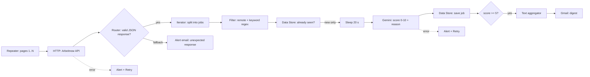

Full scenario canvas:

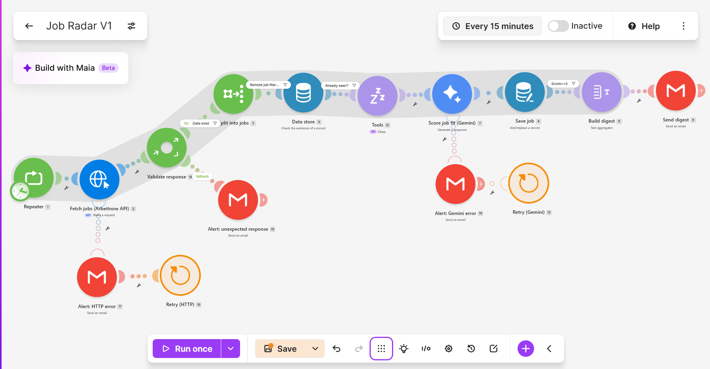

## Version history

| Version | What was added |
|---|---|
| V1 | Fetch jobs, filter remote jobs, save to Data Store (key = slug) |
| V2 | Only new jobs: existence check before saving, so repeat runs cost almost nothing |
| V3 | Gemini fit scoring with structured JSON output (score + reason) |
| V4 | Digest email (score >= 5), error alerts with Retry, response guard (router + fallback) |

---

## Technical decisions

**Page-based pagination with a Repeater.** The API returns the next page link in the response body (`links.next`), the last page has an empty `data` array, and the meta numbers are unreliable. The pipeline therefore iterates pages with the Repeater (`?page=i`) and keeps the number of pages small. Newest jobs come first, so a daily run needs few pages.

**Cheap checks first, paid steps last.** Filters and the router are not counted as operations, while every module operation costs a credit. The remote/keyword filter and the "already seen" check therefore come **before** the Gemini call, so only genuinely new, relevant jobs reach the AI step.

**Slug as Data Store key.** The Arbeitnow slug is unique per job. Using it as the key with "overwrite existing record" means a job can never be duplicated, and the existence check is a single lookup.

**Keyword regex with word boundaries.** Plain substring matching causes false positives ("AI" inside other words). The filter uses a case-insensitive pattern with `\b` word boundaries for short terms such as AI and KI, and includes German terms (for example "Automatisierung") because the board is German-focused.

**Structured AI output.** The Gemini step uses system instructions for the fixed part (role, candidate profile, scoring rubric, strict JSON format) and the user message for the variable part (the job data). The model returns `{"score": ..., "reason": ...}`, which Make exposes as separate fields, so no extra parsing module is needed.

**Description cleaned and truncated.** The raw description is HTML. It is passed through `stripHTML` first and then `substring(..., 0, 2000)`. Stripping first means the 2000 characters are real text, not tags, and it keeps token usage and quota low.

**Save after scoring.** A job is written to the Data Store only after Gemini succeeds. If Gemini fails, the job is not stored, so it is scored again on a later run and nothing is lost silently.

**Digest grouping.** The text aggregator uses the **Repeater** as its source module, so jobs from all pages end up in a single email instead of one email per page. "Stop processing after an empty aggregation" is enabled, so no empty email is sent when nothing qualifies.

**Rate limiting.** The Gemini free tier allowed 5 requests per minute at the time of testing. A Sleep module (20 seconds) before the Gemini call keeps the pipeline under that limit.

**Response guard.** A bad URL returned HTTP 200 with an HTML page, which Make treated as a success. The router now lets a response through only if the job array exists **and** the `Content-Type` header is JSON; anything else goes to a fallback route that sends an alert.

**Error handling.** HTTP and Gemini both have an error route: alert email, then Retry (3 retries for HTTP, 2 for Gemini, 15 minutes apart). Retry saves the failed run as an incomplete execution.

---

## Testing and results

Each test below states what I did, what I expected, what happened, and the evidence.

### Test A: full run, 3 pages, empty Data Store

*Setup:* Data Store emptied, 3 pages, score threshold temporarily lowered to 0 so the digest email could be demonstrated.

*Result:* 3 pages fetched, 7 remote keyword matches reached Gemini, 6 were scored and saved, 1 call failed with a temporary Gemini error (see Test D), and **one** digest email contained the jobs from all pages. The aggregator combined 6 jobs into 1 bundle.

| Evidence | |
|---|---|
| Canvas with operation counts | 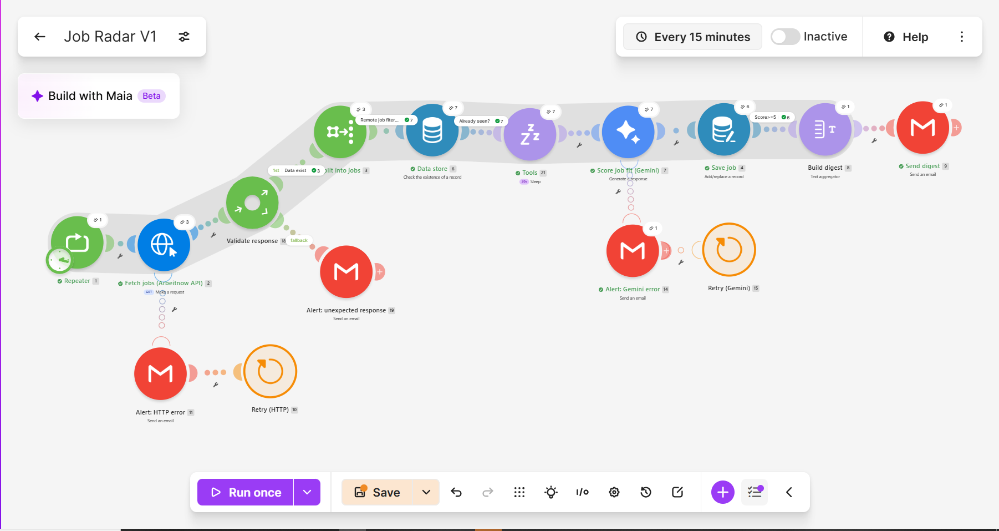 |
| Aggregator output (6 jobs, 1 bundle) | 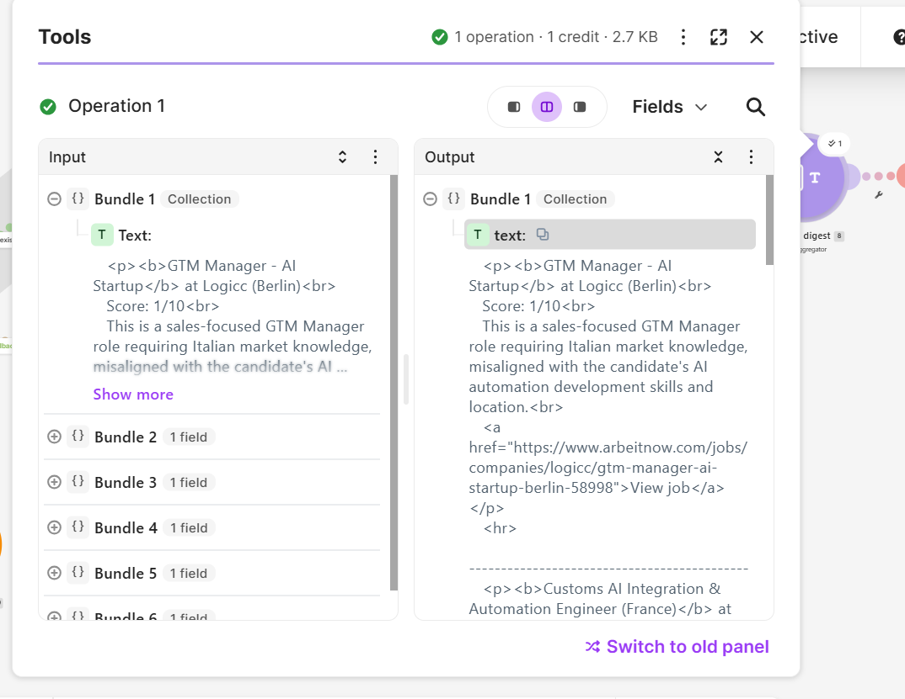 |
| Digest email | 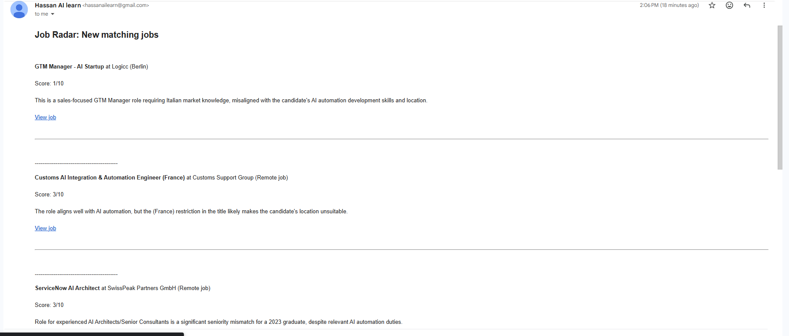 |
| Stored records | 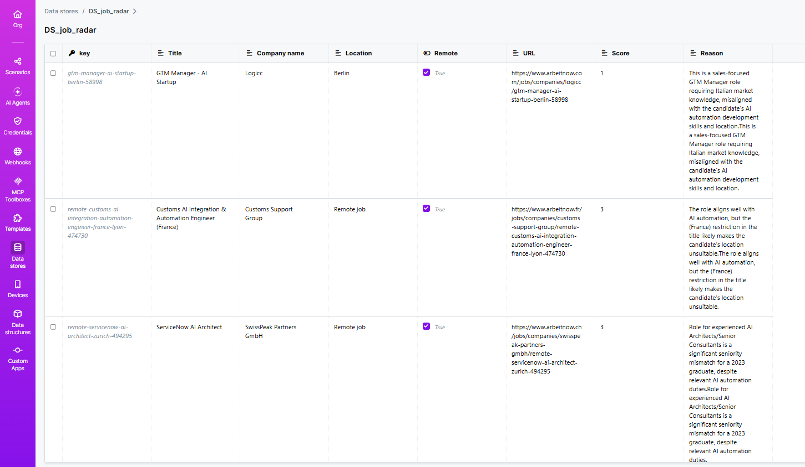 |

*Known issue:* in the stored records the `Reason` text appears twice. The Gemini output contains it once (see the aggregator output and the email); the duplication comes from a double mapping in the **Save job** module and does not affect scoring or the digest.

### Test B: dedupe (second run, Data Store already filled)

*Expectation:* jobs already stored must not reach Gemini again.

*Result:* 4 jobs passed the remote/keyword filter, **all 4 were recognised as already seen**, and Sleep, Gemini and Save job had **0 operations**. A repeat run therefore costs only the fetch and the existence checks.

| Evidence | |
|---|---|
| Canvas: 4 jobs in, 0 passed the "already seen" filter | 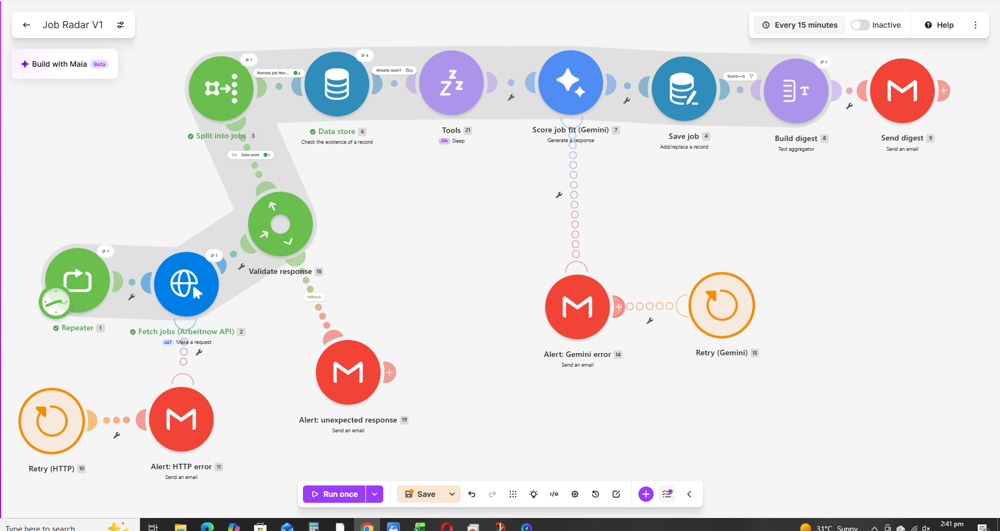 |
| Existence check output | 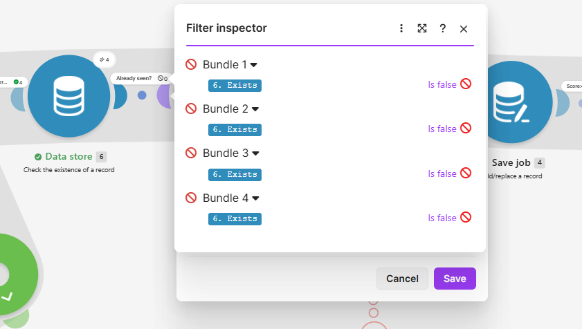 |

### Test C: response guard (bad URL)

*Setup:* the API path was changed on purpose. The server answered with an HTML page and status 200.

*Result:* the first version of the guard checked only that the job array existed, and let this response through. I added the `Content-Type` check. With both rules, the normal route did not run and the fallback route sent an alert showing the status code and content type.

| Evidence | |
|---|---|
| Router filter (both rules) | 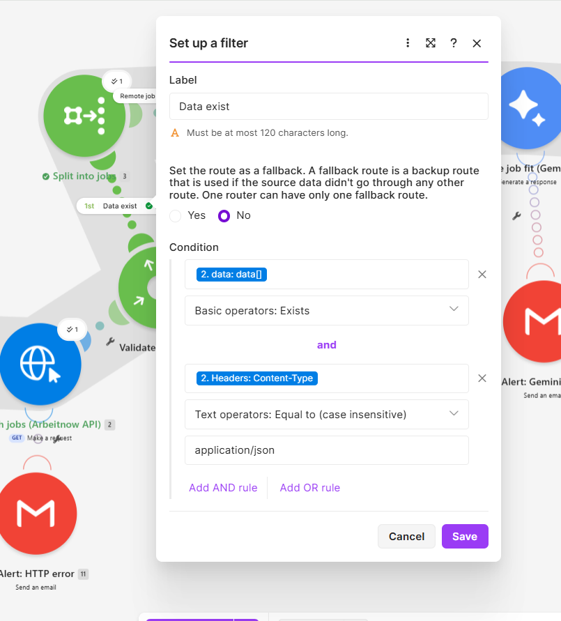 |
| Fallback alert email | 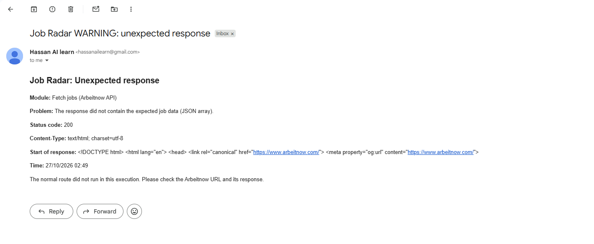 |

During testing I also found a bug in my own guard: a rule compared the whole `Headers` collection instead of the `Content-Type` field, so every response was sent to the fallback. Testing with real traffic caught it, and I fixed the field.

### Test D: error handling

| Case | What happened | Evidence |
|---|---|---|
| HTTP server error (500) | Error route sent an alert and Retry saved the run | 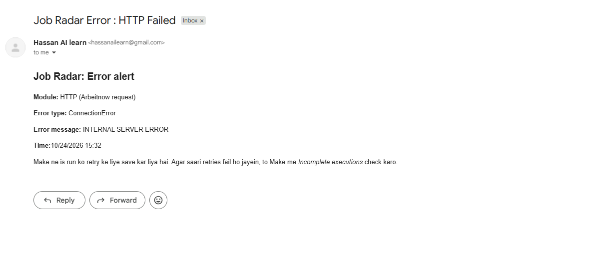 |
| Gemini rate limit (429, 5 requests/minute) | Early runs without Sleep failed on some jobs; alert email showed the error and the job title | 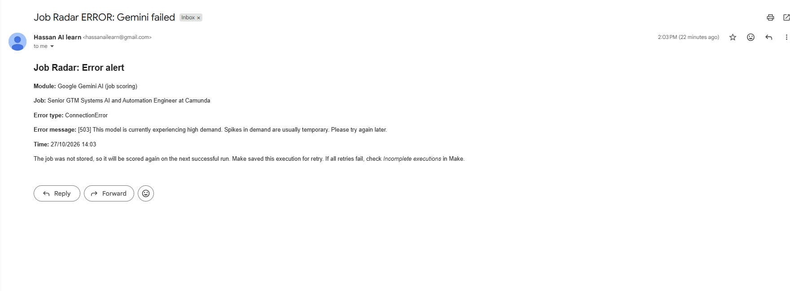 |
| Gemini overload (503, "high demand") | After adding Sleep, one call still failed with a temporary 503; it was caught, the job was not stored, and an alert was sent | 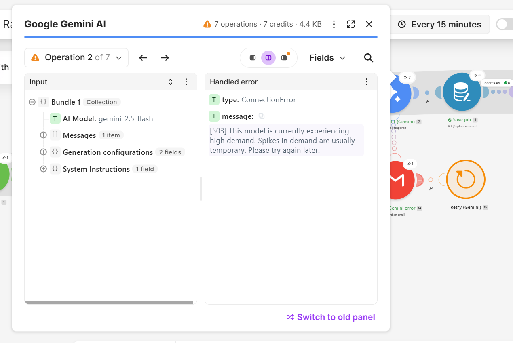 |

Adding the Sleep module removed the rate-limit failures. A 503 is a temporary server-side error that can still happen, which is exactly what the alert and Retry route is for.

### Score threshold and prompt

| Threshold filter | Prompt (system instructions) |
|---|---|
| 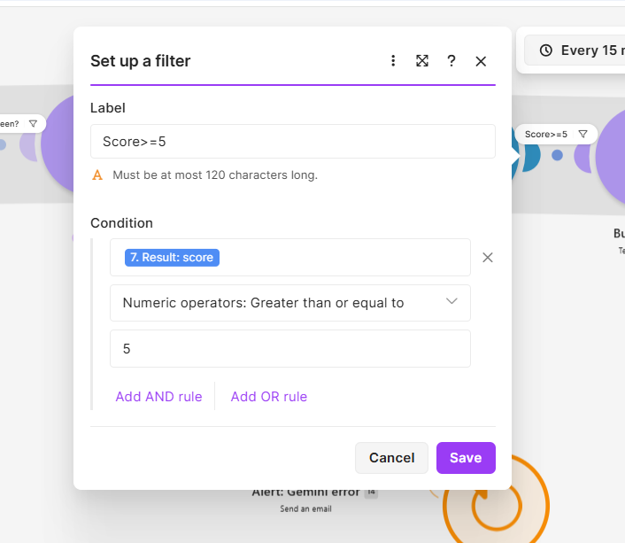 | 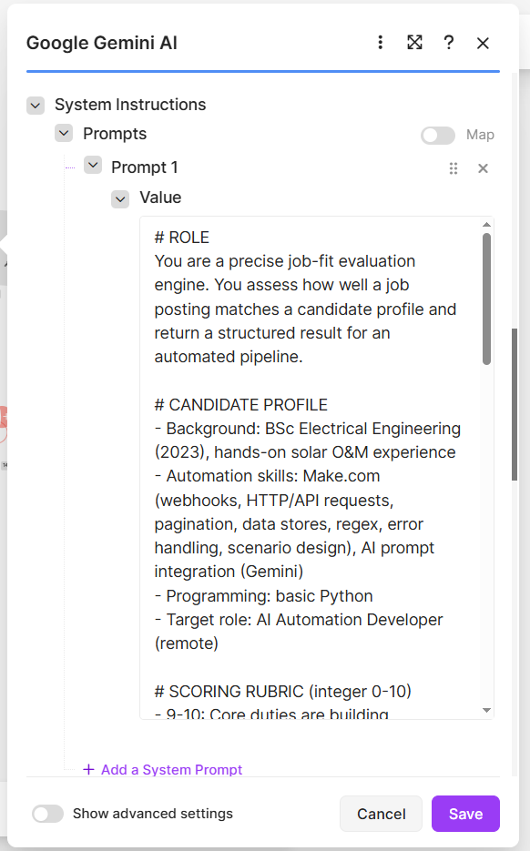 |

---

## Evaluating the AI scoring

I checked the model's scores against the job descriptions instead of trusting them.

**A wrong score and how I fixed it.** A "Test Automation Engineer" posting first received a score of **7**. The job needed 5+ years of experience, was limited to candidates inside the EU, and was software QA testing, not workflow automation. The model had only seen the title, company, location and tags. After adding the cleaned description (first 2000 characters) and stricter rules to the prompt, the same job scored **1**, and the reason named all three problems.

| | Input to Gemini | Score |
|---|---|---|
| Before | title, company, location, tags | 7 |
| After | + description (2000 characters) + rules for seniority, region restrictions and QA testing | 1 |

**Sample of stored records from the demo run:**

| Job | Score | Gemini's reasoning (short) |
|---|---|---|
| GTM Manager - AI Startup | 1 | Sales role requiring a specific market language |
| Customs AI Integration & Automation Engineer (France) | 3 | Good topical match, but a location restriction in the title |
| ServiceNow AI Architect | 3 | Relevant duties, but a senior role |

This is a small sample, so it shows how the scoring behaves; it is not a measured accuracy figure. Scores can still be wrong, and borderline cases (such as location restrictions mentioned only in the title) deserve a manual look.

---

## Cost and limits

* One module operation costs one credit. For example, Gemini with 7 operations used 7 credits, and the HTTP module with 3 operations used 3 credits. Filters and the router were not counted.
* A repeat run with nothing new is cheap (fetch + iterator + existence checks only). Credit numbers for whole runs are estimates from the operation counts.
* Free plan limits I worked within: 1,000 credits per month, 2 active scenarios, a 5-minute maximum run time. With a 20-second sleep per new job, roughly 13 new jobs fit into one run.
* Alerts fire on **each** failure (first attempt and every retry). I did not add logic to send a single final alert.
* When the scenario is inactive, saved incomplete executions are not retried automatically.

## Known limitations

* **Data source:** Arbeitnow is a German-focused board, so few jobs match a remote junior AI-automation profile. Many results are senior or region-restricted.
* **Single profile:** the candidate profile, the keyword regex and the score threshold are hard-coded in the scenario.
* **Scoring input:** only metadata and the first 2000 characters of the description are scored.
* **One source:** no other job boards are combined.
* **Reason duplicated** in the stored records (mapping issue described in Test A).
* The Gemini free-tier limits (requests per minute, availability) can change; the 20-second sleep is tuned to the limit I observed.

## How to adapt this scenario

1. **Candidate profile and rubric:** edit the Gemini *System Instructions* (profile, target role, scoring rules, location).
2. **Keywords:** edit the regex in the *Filter* after the Iterator.
3. **Minimum score:** edit the filter before the text aggregator.
4. **Pages:** change *Repeats* on the Repeater (page 1 is usually enough for a daily run because newest jobs come first).
5. **Recipient and sender:** set your own mailbox in the Gmail modules.

### Setup

1. Create a Data Store `DS_job_radar` with a structure containing: `slug` (key), `title`, `company_name`, `location`, `remote` (boolean), `url`, `tags` (text), `created_at` (number), `score` (number), `reason` (text).
2. Import `blueprint/job-radar-blueprint.json` into Make (a sanitized export: connections and email addresses are removed).
3. Create your own **Gmail** and **Google Gemini** connections and select them in the modules. Never commit API keys.
4. Run once manually, then check the Data Store before activating any schedule.

## Possible next steps

* Add a second source (for example another remote job API) and merge the results using a common field schema.
* Move the profile, keywords and threshold into a config Data Store so the scenario becomes a reusable template.
* Stop paginating automatically once a page contains only already-seen jobs.
* Send one final alert after all retries fail, instead of one per attempt.
* Add an "eligible from my country" field to the Gemini output.

## What I practiced

Page-based pagination, Data Stores (existence checks, overwrite by key), regex filters, structured AI output, aggregators and grouping, rate limiting, router fallback routes, error handlers with Retry, and testing a scenario with real failures and then fixing what the tests exposed.

## Credits and attribution

* Job data from [Arbeitnow](https://www.arbeitnow.com) (free API, no key). Jobs are linked back to their Arbeitnow pages, and the digest email names the source.
* Built with [Make](https://www.make.com) and Google Gemini.

## Author

Hassan Haider, GitHub: [HassanHaider-ai](https://github.com/HassanHaider-ai/)
